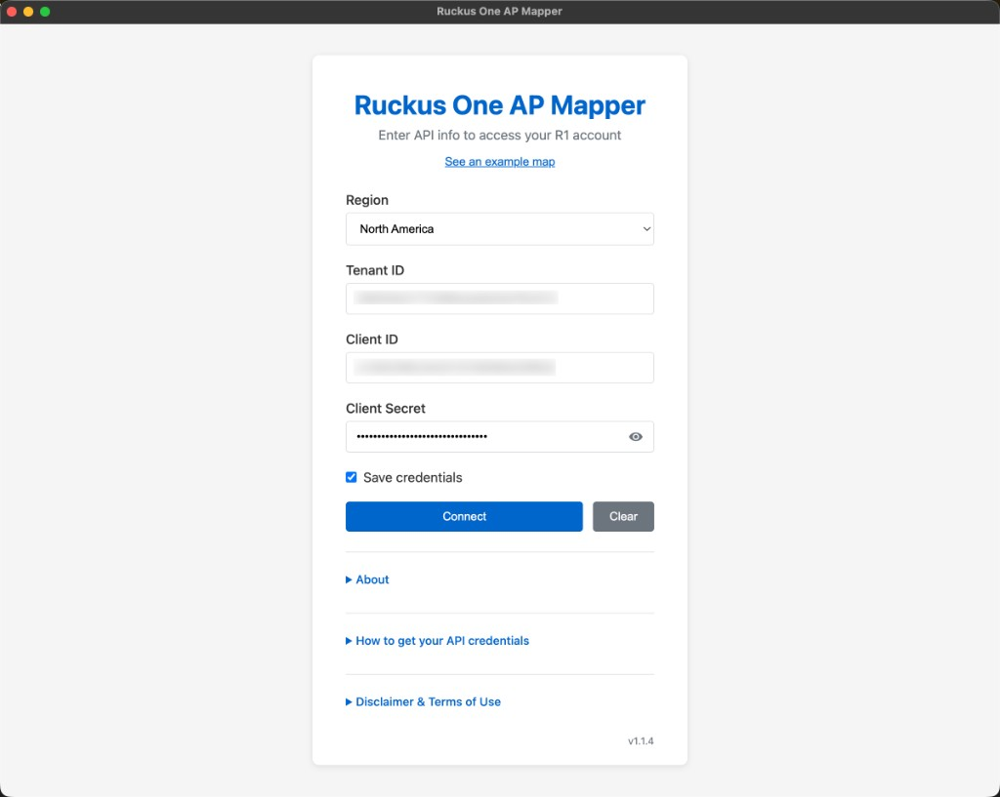
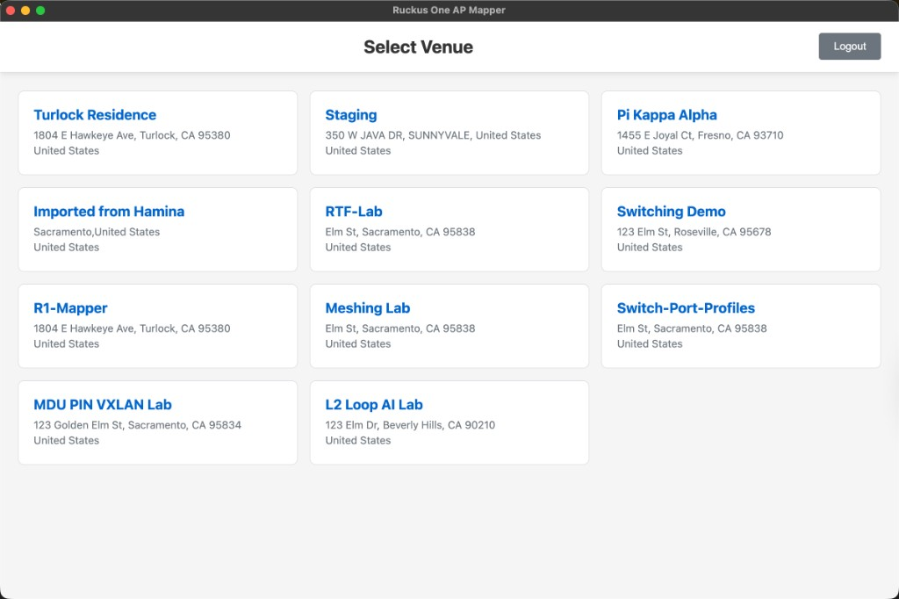
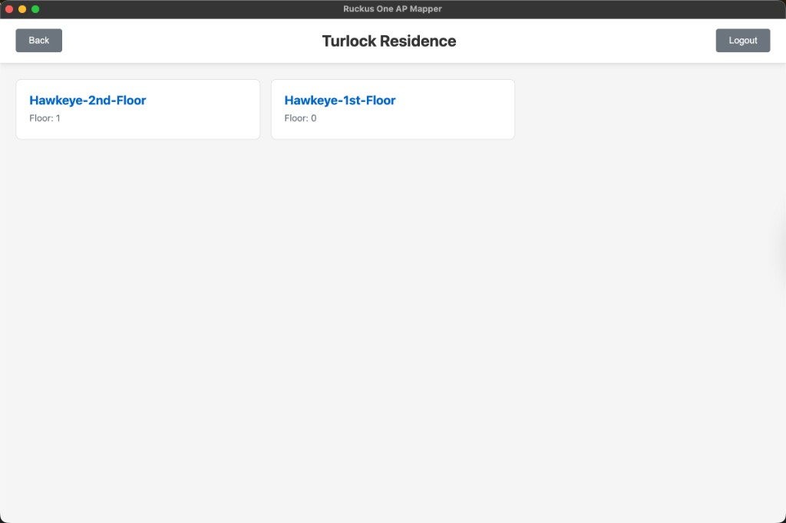
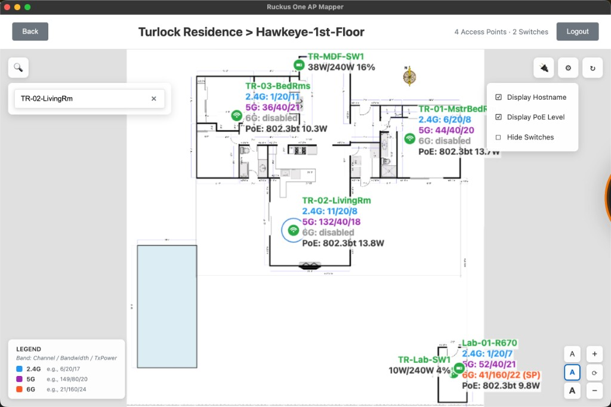
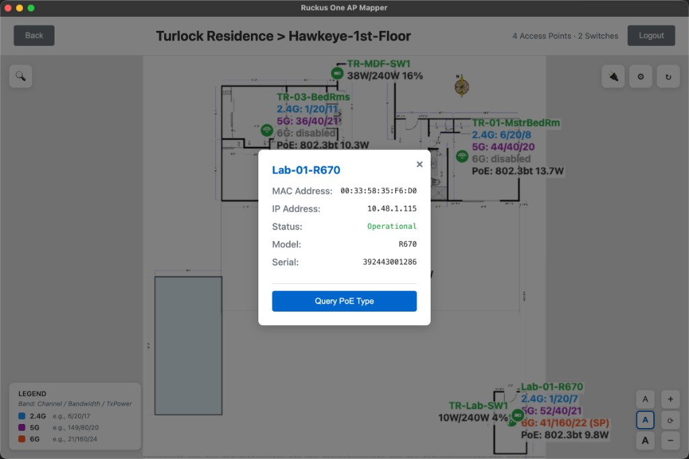
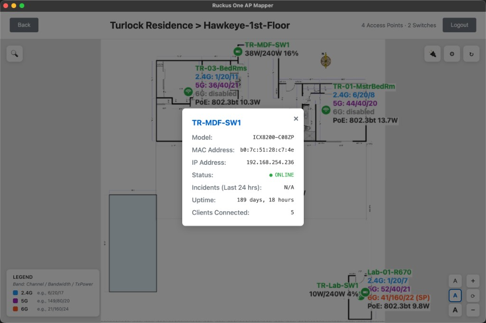

# Ruckus One AP Mapper

Desktop app for viewing Ruckus ONE access points on venue floor plans, with RF details (channel, bandwidth, transmit power) and optional PoE information.  Adds AFC power state if 6GHz is enabled.  This gives you a holistic view of all devices on a floor plan with RF info at a glance.

This is an unofficial, community-developed tool and is not affiliated with Belden Inc. or Ruckus a Belden Brand.

## Download

Installers are on the **[Releases](https://github.com/MibenSmmod/Ruckus1-AP-Mapper/releases)** page (also linked in the repo sidebar under **About**).

**Latest (v1.1.4):**

| Platform | Download |
|----------|----------|
| macOS (Apple Silicon) | [Ruckus One AP Mapper-1.1.4-arm64.dmg](https://github.com/MibenSmmod/Ruckus1-AP-Mapper/releases/download/v1.1.4/Ruckus.One.AP.Mapper-1.1.4-arm64.dmg) |
| macOS (Intel) | [Ruckus One AP Mapper-1.1.4-x64.dmg](https://github.com/MibenSmmod/Ruckus1-AP-Mapper/releases/download/v1.1.4/Ruckus.One.AP.Mapper-1.1.4-x64.dmg) |
| Windows (x64) | [Ruckus One AP Mapper-1.1.4-Setup.exe](https://github.com/MibenSmmod/Ruckus1-AP-Mapper/releases/download/v1.1.4/Ruckus.One.AP.Mapper-1.1.4-Setup.exe) |

On macOS, the app is unsigned — right-click the app and choose **Open** the first time, or allow it in **System Settings → Privacy & Security**.

## Features

- Sign in with Ruckus ONE API credentials (region, tenant ID, client ID, client secret)
- Browse venues and floor plans
- Overlay APs on floor plan images with status and RF labels
- Optional hostname and PoE level display
- Search APs by hostname or serial number
- Zoom, pan, and font-size controls
- Click device icon for more information (IP address, MAC address, etc.)

## Screenshots

### Login



### Select venue



### Select floor plan



### Map view



### AP details



### Switch details



## Requirements

- A Ruckus ONE account at [https://ruckus.cloud/](https://ruckus.cloud/)
- An Application Token (Read Only recommended) and Tenant ID
- For running from source: Node.js 18 or higher

## Run from source

```bash
npm install
npm start
```

## Build installers

```bash
# macOS .dmg
npm run build:dmg

# Windows installer
npm run build:win
```

## Getting API credentials

1. Log in at [https://ruckus.cloud](https://ruckus.cloud)
2. **Administration** → **Account Management** → **Settings**
3. Under **Application Tokens**, add a token (Read Only recommended)
4. Copy the **Client ID** and **Shared Secret**
5. Get **Tenant ID** from the URL after login, or from **User Profile**

## Author

Mike Rieben — [LinkedIn](https://www.linkedin.com/in/mikerieben/)
