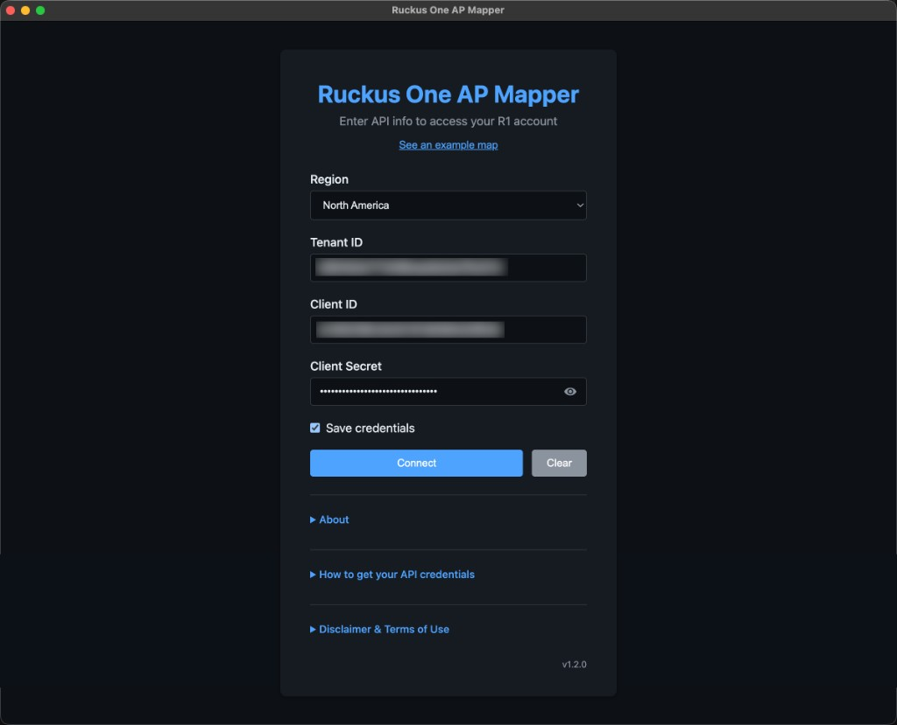

# Ruckus One AP Mapper

Desktop app for viewing Ruckus ONE access points on venue floor plans, with RF details (channel, bandwidth, transmit power) and optional PoE information.  Adds AFC power state if 6GHz is enabled.  This gives you a holistic view of all devices on a floor plan with RF info at a glance.

## Disclaimer

This is an unofficial, community-developed tool. It is **not** affiliated with, endorsed by, or officially supported by Belden Inc., Ruckus (a Belden Brand), or any of their affiliates. Use of Ruckus / Belden trademarks is for identification only.

**Provided as-is, with no warranty of any kind.** The authors and contributors make no guarantees about fitness for a particular purpose, correctness, availability, or that use of this software will not cause issues in your environment. You use it at your own risk. The authors are not responsible for any damages, data loss, service disruption, or other consequences arising from use of this application.

## Download

Installers are on the **[Releases](https://github.com/MibenSmmod/Ruckus1-AP-Mapper/releases)** page (also linked in the repo sidebar under **About**).

**Latest (v1.2.0):**

| Platform | Download |
|----------|----------|
| macOS (Apple Silicon) | [Ruckus One AP Mapper-1.2.0-arm64.dmg](https://github.com/MibenSmmod/Ruckus1-AP-Mapper/releases/download/v1.2.0/Ruckus.One.AP.Mapper-1.2.0-arm64.dmg) |
| macOS (Intel) | [Ruckus One AP Mapper-1.2.0-x64.dmg](https://github.com/MibenSmmod/Ruckus1-AP-Mapper/releases/download/v1.2.0/Ruckus.One.AP.Mapper-1.2.0-x64.dmg) |
| Windows (x64) | [Ruckus One AP Mapper-1.2.0-Setup.exe](https://github.com/MibenSmmod/Ruckus1-AP-Mapper/releases/download/v1.2.0/Ruckus.One.AP.Mapper-1.2.0-Setup.exe) |

macOS builds are signed and notarized by Apple, so they open normally. The Windows installer is signed by WLAN GEEKS LLC; Windows SmartScreen may still show a prompt for a new release until it builds download reputation.

## Features

- Sign in with Ruckus ONE API credentials (region, tenant ID, client ID, client secret)
- Browse venues and floor plans
- Overlay APs on floor plan images with status and RF labels
- Optional hostname and PoE level display
- Search APs by hostname or serial number
- Zoom, pan, and font-size controls
- Click device icon for more information (IP address, MAC address, etc.)

## Screenshots

### Login



### Select venue


### Select floor plan


### Map view


### AP details


### Switch details


## Requirements

- A Ruckus ONE account at [https://ruckus.cloud/](https://ruckus.cloud/)
- An Application Token (Read Only recommended) and Tenant ID
- For running from source: Node.js 18 or higher

## Run from source

```bash
npm install
npm start
```

## Build installers

```bash
# macOS — Apple Silicon (M1 and later) .dmg
npm run build:mac-arm64

# macOS — Intel .dmg
npm run build:mac-x64

# Windows installer (.exe)
npm run build:win

# All three at once
npm run build:all
```

Installers are written to `dist/`. Build the macOS DMGs on a Mac; both architectures can be built from either an Apple Silicon or Intel Mac.

## Getting API credentials

1. Log in at [https://ruckus.cloud](https://ruckus.cloud)
2. **Administration** → **Account Management** → **Settings**
3. Under **Application Tokens**, add a token (Read Only recommended)
4. Copy the **Client ID** and **Shared Secret**
5. Get **Tenant ID** from the URL after login, or from **User Profile**

## License

[MIT](LICENSE)

## Author

Mike Rieben — [LinkedIn](https://www.linkedin.com/in/mikerieben/)
